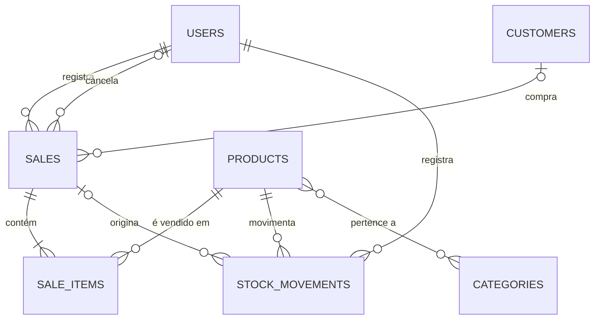

# Modelo de dados

Este documento descreve o modelo de dados do sistema. Ele substitui o diagrama `der.jpeg` como referência, que continua disponível no mesmo diretório como registro da primeira versão do modelo.

O schema é criado pela migration `V1__CREATE_INITIAL_SCHEMA.sql` (ADR-0011) e roda em PostgreSQL 16 (ADR-0002).

## Diagrama de relacionamentos

## Convenções

- Nomes de tabelas e colunas em inglês, em `snake_case`, e tabelas no plural (ADR-0010).
- Chaves primárias são `BIGINT GENERATED ALWAYS AS IDENTITY`.
- Valores monetários são `NUMERIC(10,2)`. Quantidades e estoque são `NUMERIC(10,3)`.
- Datas e horas são `TIMESTAMP`, e datas sem hora são `DATE`.
- Exclusão lógica, nas tabelas `products` e `customers`, usa a coluna `deleted_at` (ADR-0006).
- Em `products` e `customers`, os campos únicos são únicos apenas entre registros ativos (`WHERE deleted_at IS NULL`), por índice único parcial (ADR-0006).
- Enums são armazenados como `VARCHAR` com `CHECK` que restringe os valores aceitos.

## Tabelas

### users

| Coluna | Tipo | Nulo | Observações |
|---|---|---|---|
| id | BIGINT | não | Identidade gerada |
| name | VARCHAR(100) | não | |
| email | VARCHAR(100) | não | Único |
| username | VARCHAR(100) | não | Único |
| password | VARCHAR(255) | não | Armazenada com hash |
| role | VARCHAR(50) | não | `ADMIN` ou `USER` |
| birthday_date | DATE | sim | |
| active | BOOLEAN | não | Padrão `true`. Usuário inativo não autentica (ADR-0006) |

### categories

| Coluna | Tipo | Nulo | Observações |
|---|---|---|---|
| id | BIGINT | não | Identidade gerada |
| name | VARCHAR(255) | não | |
| description | TEXT | sim | |

### products

| Coluna | Tipo | Nulo | Observações |
|---|---|---|---|
| id | BIGINT | não | Identidade gerada |
| name | VARCHAR(255) | não | |
| barcode | VARCHAR(50) | sim | Único entre ativos (ADR-0009) |
| price | NUMERIC(10,2) | não | `>= 0` |
| unit | VARCHAR(2) | não | `UN` ou `KG` (ADR-0009) |
| description | TEXT | não | |
| stock | NUMERIC(10,3) | não | Saldo atual, `>= 0` (ADR-0005) |
| version | BIGINT | não | Controle de concorrência, padrão 0 |
| created_at | TIMESTAMP | sim | Preenchido pela auditoria |
| updated_at | TIMESTAMP | sim | Preenchido pela auditoria |
| deleted_at | TIMESTAMP | sim | Exclusão lógica (ADR-0006) |

### product_category

Tabela de associação N:N entre produtos e categorias. A chave primária é composta por `product_id` e `category_id`. Ao excluir um produto ou uma categoria, os vínculos são removidos em cascata.

| Coluna | Tipo | Nulo | Observações |
|---|---|---|---|
| product_id | BIGINT | não | FK para `products` |
| category_id | BIGINT | não | FK para `categories` |

### customers

| Coluna | Tipo | Nulo | Observações |
|---|---|---|---|
| id | BIGINT | não | Identidade gerada |
| name | VARCHAR(255) | não | Obrigatório (UC07) |
| phone | VARCHAR(20) | não | Obrigatório (UC07) |
| email | VARCHAR(255) | sim | |
| birthday_date | DATE | sim | |
| cpf_cnpj | VARCHAR(14) | sim | Somente dígitos, 11 ou 14 caracteres. Único entre ativos (ADR-0009) |
| street | VARCHAR(150) | sim | Endereço (embeddable `Address`) |
| number | VARCHAR(20) | sim | Endereço |
| complement | VARCHAR(100) | sim | Endereço |
| neighborhood | VARCHAR(100) | sim | Endereço |
| city | VARCHAR(100) | sim | Endereço |
| state | VARCHAR(2) | sim | Endereço |
| zip_code | VARCHAR(10) | sim | Endereço |
| created_at | TIMESTAMP | sim | Preenchido pela auditoria |
| updated_at | TIMESTAMP | sim | Preenchido pela auditoria |
| deleted_at | TIMESTAMP | sim | Exclusão lógica (ADR-0006) |

### sales

| Coluna | Tipo | Nulo | Observações |
|---|---|---|---|
| id | BIGINT | não | Identidade gerada |
| date | TIMESTAMP | não | Data da venda |
| subtotal | NUMERIC(10,2) | não | `>= 0`. Recalculado no rascunho e congelado na finalização (UC09, UC13) |
| status | VARCHAR(20) | não | `DRAFT`, `CANCELLED` ou `COMPLETED` |
| customer_id | BIGINT | sim | FK para `customers`. Venda pode não ter cliente |
| user_id | BIGINT | não | FK para `users`. Responsável pela venda |
| created_at | TIMESTAMP | sim | Preenchido pela auditoria |
| updated_at | TIMESTAMP | sim | Preenchido pela auditoria |
| cancelled_at | TIMESTAMP | sim | Obrigatório quando `CANCELLED` |
| cancelled_by_user_id | BIGINT | sim | FK para `users`. Obrigatório quando `CANCELLED` |
| cancel_reason | TEXT | sim | Obrigatório e não vazio quando `CANCELLED` (ADR-0007) |
| version | BIGINT | não | Controle de concorrência, padrão 0 |

### sale_items

| Coluna | Tipo | Nulo | Observações |
|---|---|---|---|
| id | BIGINT | não | Identidade gerada |
| product_id | BIGINT | não | FK para `products` |
| quantity | NUMERIC(10,3) | não | `> 0` |
| unit_price | NUMERIC(10,2) | não | `>= 0`. Copiado do produto na inclusão (UC09) |
| sale_id | BIGINT | não | FK para `sales`. Excluído em cascata com a venda |

Um mesmo produto aparece no máximo uma vez por venda (`UNIQUE (sale_id, product_id)`).

### stock_movements

| Coluna | Tipo | Nulo | Observações |
|---|---|---|---|
| id | BIGINT | não | Identidade gerada |
| product_id | BIGINT | não | FK para `products` |
| type | VARCHAR(20) | não | `ENTRY`, `SALE`, `RETURN` ou `ADJUSTMENT` |
| quantity | NUMERIC(10,3) | não | Com sinal: positivo aumenta o estoque, negativo diminui. Nunca zero |
| sale_id | BIGINT | sim | FK para `sales`. Obrigatório em `SALE` e `RETURN` |
| user_id | BIGINT | não | FK para `users`. Quem registrou a movimentação |
| created_at | TIMESTAMP | não | Preenchido pela auditoria |
| notes | TEXT | sim | Obrigatório em `ADJUSTMENT` |

Regras de sinal por tipo:

| Tipo | Sinal da quantidade | `sale_id` | `notes` |
|---|---|---|---|
| `ENTRY` | Positivo | Não aplicável | Opcional |
| `SALE` | Negativo | Obrigatório | Opcional |
| `RETURN` | Positivo | Obrigatório | Opcional |
| `ADJUSTMENT` | Positivo ou negativo | Não aplicável | Obrigatório |

Movimentações são imutáveis (ADR-0005).

## Regras que dependem da aplicação

Algumas regras não podem ser expressas apenas com constraints do banco. Elas são validadas no código e cobertas por testes:

- Produtos `UN` aceitam apenas quantidades inteiras (ADR-0009).
- Uma venda `COMPLETED` precisa ter pelo menos um item (DOMAIN).
- O `subtotal` de um rascunho é igual à soma de `quantity * unit_price` dos itens.
- Finalizar uma venda cria as movimentações `SALE` e atualiza `products.stock` na mesma transação, com bloqueio do produto (ADR-0005).

## Testes de schema

Os `CHECK`, os índices únicos parciais e as chaves únicas são cobertos por `SchemaConstraintsTest`, que verifica que cada violação é rejeitada pelo banco com erro de integridade.
